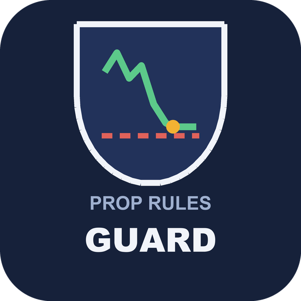
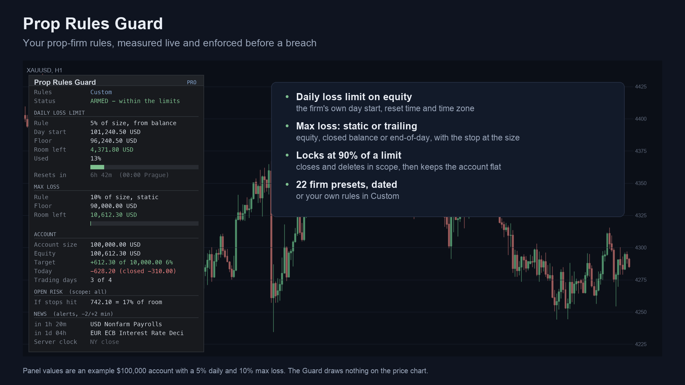
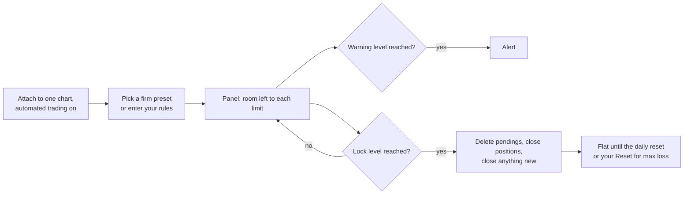
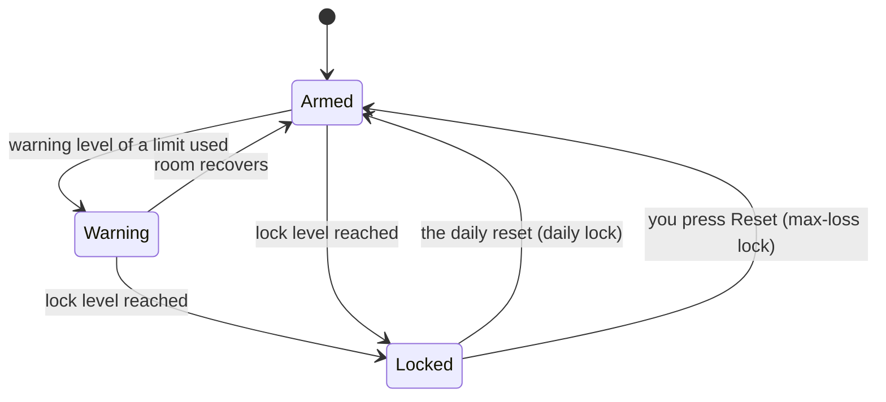
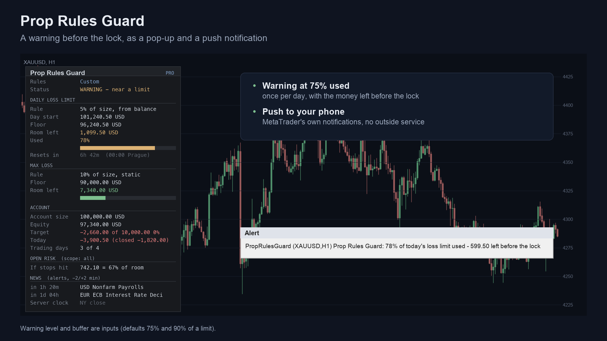
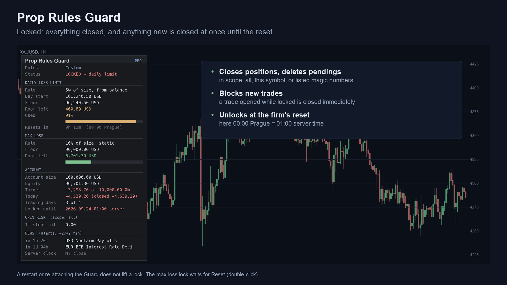
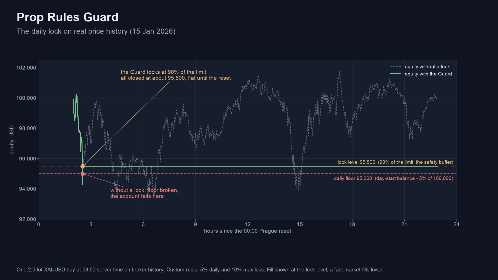
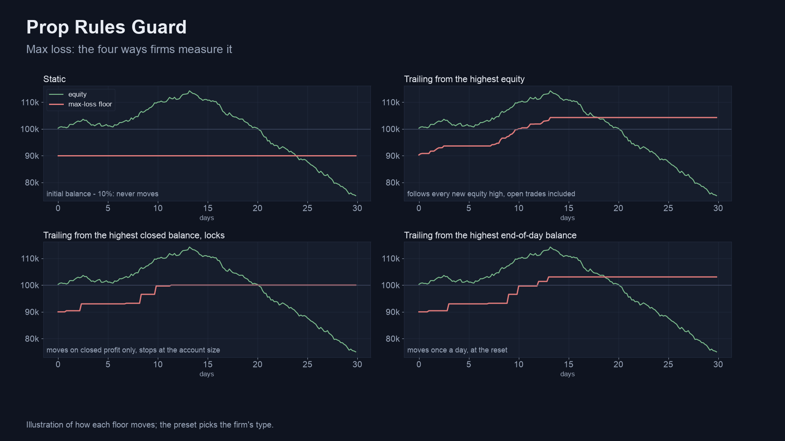
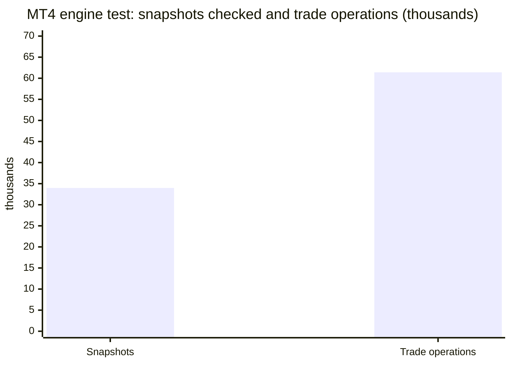

# Prop Rules Guard (MetaTrader 5 and MetaTrader 4)

A utility (Expert Advisor) that keeps a prop-firm account inside its rules. It measures the **daily loss limit** and the **max
loss** on equity, the way the firm does. At a safety buffer before a limit, it closes your trades and keeps the account flat until
the firm's daily reset. It never opens a trade, and it works with manual trading and with other Expert Advisors on the same account.

> **This is a showcase repository: documentation and images only. There is no source code here.** The product is sold on
> the MQL5 Market. The free watch-only indicator that measures the same limits has public source:
> [allanninal/prop-rules-monitor](https://github.com/allanninal/prop-rules-monitor).

**Website:** [allanninal.dev/mql5 (utilities)](https://www.allanninal.dev/mql5/#utilities) · [MT4 editions](https://www.allanninal.dev/mql5/#mt4) · [allanninal.dev](https://www.allanninal.dev)
· **Contact:** message me on [LinkedIn](https://www.linkedin.com/in/allanninal/).

## Get it on the MQL5 Market

| Product | Platform | Price | Link |
|---|---|---|---|
| **Prop Rules Guard MT5** | MT5 | paid | <https://www.mql5.com/en/market/product/201823> |
| **Prop Rules Guard MT4** | MT4 | paid | <https://www.mql5.com/en/market/product/202436> |
| Prop Rules Monitor (watch only, source on GitHub) | MT5 | free | <https://www.mql5.com/en/market/product/201817> |
| Prop Rules Monitor MT4 (watch only, source on GitHub) | MT4 | free | <https://www.mql5.com/en/market/product/202433> |

The Guard is standalone: you do not need to install the free Monitor. Details, current price and the Strategy Tester demo are on the
Market pages.

## What it does

- **Daily and max loss** on equity: the daily limit from the balance, the equity or the higher of the two at the firm's reset; the
  max loss static or trailing; the reset in the firm's time and zone, with daylight saving handled.
- **Lock** at a buffer before a limit (90% used by default, adjustable): it deletes pending orders, closes positions and closes
  anything opened while locked. A restart or re-attaching does not lift a lock. A daily lock ends at the reset; a max-loss lock
  ends when you press Reset.
- **Consistency** tracking, **news** handling that acts before a firm's window opens (inside the window it only warns), floating-loss
  and open-risk caps, profit target and trading days on the panel.
- **Firm presets:** 22 presets for well-known prop firms, each dated with the day it was checked against the firm's own rule pages.
  The list is on the Market listing. Your firm is not listed? The listing explains how to send its rules by private message on MQL5;
  the Custom preset takes any rule set meanwhile.
- **Scope:** every position, the chart's symbol, or listed magic numbers (0 = manual trades).
- **Warnings** at a chosen level (75% by default) by pop-up and push notification.

### Lock states

| | |
|---|---|
|  |  |
|  |  |

MT4 edition screenshots: [armed](images/mt4/01-guard-armed.png), [locked](images/mt4/03-guard-locked.png). Panels show an example
$100,000 account; the lock chart is one 2-lot XAUUSD trade on broker history. They are illustrations, not terminal captures, and
not trading results.

## Before you use it on a firm account

- Check your firm's policy on Expert Advisors: some allow risk-management EAs, some need approval, some forbid any purchased EA.
  The Guard only closes trades, but it is still an EA.
- Automated trading must be on, otherwise the Guard can only warn. The panel turns red when it is off.
- **The buffer lowers the chance of touching a limit. It cannot remove it.** In a fast market, a gap or a closed market, a close
  can fill beyond the lock level, even beyond the floor.
- Attach it to one chart only.

## Who it is for

Traders on prop-firm evaluations or funded accounts who want a rule check that acts before a limit. If you only want to watch your
distance to the limits, the free [Prop Rules Monitor](https://www.mql5.com/en/market/product/201817) does that without closing anything.

## Why it was built

- Prop-firm and daily-loss guards were the most repeated request in our October 2026 look at the MQL5 Freelance board: 76 of 2,014
  scraped jobs were in the prop-firm / guard group (the top repeated ask, equity and daily drawdown protection, appeared in 93 jobs;
  median budget around 75 to 115 USD).
- Firms differ in how they measure the day (reset time and zone) and the max loss (static or trailing), so a generic percentage
  stop is not enough. The Monitor shows the numbers; the Guard enforces them.
- **Honest scale:** these are bespoke jobs, not proven Market demand, and supply is crowded. The Guard promises no pass: it lowers risk.

## How it was checked (results)

The measuring engine is shared with the free Monitor and was tested as follows.

| Check | Result |
|---|---|
| Day-start and reset-zone maths against the system time-zone database, hourly 2020 to 2026, two broker clocks, five reset rules | 1,227,360 checks, 0 mismatches |
| MT4 engine, MetaTrader 4 Strategy Tester: 4 reset rules x 4 symbols + one every-tick run, history rebuilt from raw orders | 17 runs, 33,970 snapshots, all pass |
| MT4 trade operations made by the test | 61,411 |
| MT4 lock test, XAUUSD every tick, 2026 | 195 days, 53 daily locks, 0 days below the floor |
| MT5 lock stress test, XAUUSD, 1-minute OHLC model, 2026 | 196 days, 8 locks, 0 error lines; 5 days ended up to 2.45 USD below the floor |

The last row is the honest one: in a coarse-model stress test the lock fired at 90% of the limit, and gaps still let five days
close slightly past the floor. These are code and behaviour checks, not trading results, and not a promise that an account passes.

## Honest limits

- It enforces limits you set; it does not predict the market and does not ensure that an account passes or stays funded.
- Firms change their rules. Compare each preset's date with your firm's current rules.
- Nothing runs while the terminal is off; a VPS keeps it running.
- In the Strategy Tester only, it opens small demo trades so you can watch it lock; on a live or demo account it never opens a trade.
- The source is not published; this repository documents what the product does and the results of its checks.

## Free vs paid

| | Prop Rules Monitor (free) | Prop Rules Guard (paid) |
|---|---|---|
| Daily loss and max loss measured live, alerts | yes | yes |
| Lock, consistency, news, risk caps, firm presets | no | yes |
| Closes or changes trades | never | yes, at the lock |
| MT5 | [201817](https://www.mql5.com/en/market/product/201817) | [201823](https://www.mql5.com/en/market/product/201823) |
| MT4 | [202433](https://www.mql5.com/en/market/product/202433) | [202436](https://www.mql5.com/en/market/product/202436) |
| Source | [public on GitHub](https://github.com/allanninal/prop-rules-monitor) | not published |

---

**Website:** [allanninal.dev/mql5](https://www.allanninal.dev/mql5/#utilities) · [MT4](https://www.allanninal.dev/mql5/#mt4) · [allanninal.dev](https://www.allanninal.dev)
· Questions: message me on [LinkedIn](https://www.linkedin.com/in/allanninal/). All rights reserved, see [LICENSE](LICENSE).
